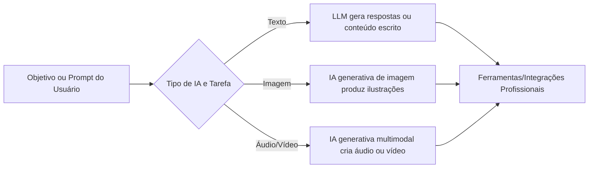

# Soluções de IA para Empresas: panorama e projeções (2026–2030)

## Sumário Executivo  
- **Modelos de Linguagem (LLMs)**: IA que lê/escreve textos (ex.: ChatGPT, Bard). Usados em chatbots, resumos, traduções e geração de conteúdo. *Requisitos mínimos:* acesso a dados de texto e APIs. *Futuro máximo:* modelo próprio treinado e integrado à empresa. Grau: **Altamente recomendado/Obrigatório** – “como ter um secretário digital que ajuda 24h”.  
- **Geração de Imagens**: IA que cria imagens a partir de texto (ex.: DALL·E, Midjourney). Útil para marketing e design rápido. *Mínimo:* ferramentas prontas e bons “prompts”. *Máximo:* modelos personalizados à marca e fluxo de design automatizado. Grau: **Recomendado** (especialmente em marketing) – “é como ter um artista sempre disponível para elaborar peças visuais”.  
- **Geração de Áudio**: IA que compõe música ou sintetiza vozes (ex.: ElevenLabs, Aiva, Jukebox). Serve para jingles, dublagens, assistentes de voz. *Mínimo:* acesso a banco de vozes IA. *Máximo:* clones de voz realistas e produção musical automática. Grau: **Melhoria** – “imagine um músico/locutor virtual pronto para produzir áudio sob demanda”.  
- **Geração de Vídeo**: IA que produz vídeos por texto (ex.: Runway Gen-2, Synthesia). Ainda incipiente, mas cresce rápido. *Mínimo:* conteúdo básico (animações simples). *Máximo:* vídeos realistas de produto/cena gerados automaticamente. Grau: **Experimental**, porém em ascensão – “como se dizer ao computador: ‘Faça um vídeo assim’ em vez de filmar”.  
- **Agentes Autônomos de IA**: Sistemas que planejam e executam tarefas sozinhos (ex.: RPA avançado, bots com GPT-4+plugins). Em vez de comandos diretos, eles “pensam” em metas e agem (monitoram e-mails, fazem agendamentos, atendem clientes). *Mínimo:* integração com sistemas da empresa (agenda, CRM) e processos estruturados. *Máximo:* verdadeiros “colegas digitais” autônomos fazendo operações críticas. Grau: **Altamente recomendado/Depende** – “é como ter um funcionário virtual que aprende e executa tarefas”.  
- **Visão Computacional**: IA que analisa imagens/vídeo (ex.: detecção de defeitos em fábrica, câmeras de segurança inteligentes). *Mínimo:* câmeras e modelos prontos para tarefas comuns. *Máximo:* sensores conectados em tempo real e inspeção automatizada contínua. Grau: **Obrigatório** em manufatura e segurança – “como ter 100 olhos atentos inspecionando cada peça”.  
- **Análise Preditiva (Machine Learning tradicional)**: Modelos que prevêm vendas, demanda, fraudes etc. (ex.: previsões de estoque, risco de crédito). *Mínimo:* dados históricos organizados e análises básicas. *Máximo:* sistemas em tempo real ajustando preços/previsões continuamente. Grau: **Obrigatório** – “é como ter uma previsão do tempo interna do mercado ajudando na estratégia”.  
- **Automação de Processos (RPA)**: Robôs de software que repetem tarefas administrativas (ex.: lançamento de notas fiscais, entrada de dados). *Mínimo:* ferramentas RPA simples. *Máximo:* RPA com IA cognitiva capaz de ler e-mails e aprender fluxos. Grau: **Altamente recomendado** – “equivale a uma equipe de autômatos cuidando de tarefas monótonas”.  

Cada solução acima é avaliada em tabela comparativa com exemplos e requisitos. Com base em projeções de mercado (ex.: **65%** das empresas já usam IA generativa em 2024, **77%** investem em 2025), espera-se uso generalizado nos próximos anos. A seguir, cada categoria é detalhada em linguagem simples, com analogias ao mundo real e grau de necessidade para empresas. Ademais, visuais como fluxogramas ilustram como os agentes de IA e a adoção evoluem.

---

## Modelos de Linguagem (LLMs) e Chatbots  
**O que é:** Software de IA treinado em muito texto que pode ler, entender e **gerar texto em linguagem humana**. Exemplos atuais incluem ChatGPT (OpenAI), Google Gemini, Bard, LLaMA, etc. São a base de chatbots conversacionais e ferramentas de escrita automática.  

**Exemplos de uso:** atendimento ao cliente (chatbots inteligentes), redatores automáticos de e-mails e documentos, tradutores e sumarizadores automáticos.  

**Requisitos mínimos:** acesso a pelo menos uma API de LLM (como OpenAI ou Azure AI), dados de contexto (como históricos de chat ou documentos internos) e funcionários com treinamento básico em prompts. Em essência, toda empresa precisa de *dados digitais organizados* e uma conexão de internet (cloud) para competir.  

**Requisitos máximos (3–10 anos):** modelos LLM próprios *finamente ajustados* ao negócio (com base em documentos e vocabulário da empresa), capacidade multimodal (trabalhar com texto, imagens e áudio juntos) e integração total com sistemas internos (CRM, ERP). No topo, teremos assistentes personalizados que conhecem os processos internos e conversam naturalmente.

**Grau de necessidade:** **Altamente recomendado** (praticamente essencial). Emprega-se analogia: hoje muitas empresas têm um “escriturário” ou atendente que digita/filtra e-mails – o LLM faz isso automaticamente com mais rapidez. É como passar de *máquina de escrever* para um *assistente digital de redação*. Com LLMs, “uma pergunta em linguagem natural gera resposta quase como de um humano, só que instantaneamente”.

| Solução (Categoria)          | Definição                                            | Exemplos                | Requisitos Mínimos                                             | Requisitos Máximos (3–10 anos)                                 | Grau Necessidade            |
|------------------------------|------------------------------------------------------|-------------------------|----------------------------------------------------------------|---------------------------------------------------------------|-----------------------------|
| **LLMs (Modelos de Linguagem)** | IA que analisa e gera texto humano de forma sofisticada. | ChatGPT (GPT-4), Google Gemini, Claude, LLaMA, etc. | Conexão com modelo em nuvem; dados/textos básicos; equipe treinada em prompt. | Modelo interno treinado; multimodalidade (texto+imagens+áudio); integração total com sistemas corporativos. | Altamente recomendado / Obrigatório |

*Analogias:* Hoje, escrever relatórios ou responder e-mails pode ser como digitar manualmente. No futuro, um modelo de linguagem será como um **secretário digital** que entende e escreve para você, tornando essa tarefa quase automática.  

---

## Geração de Imagens com IA  
**O que é:** Sistemas de IA capazes de **criar imagens novas** a partir de comandos de texto ou rascunhos. Isso inclui arte, design de produto, ilustrações publicitárias etc. Ferramentas populares: DALL·E, Midjourney, Stable Diffusion, Google Imagen, Leonardo.AI.  

**Exemplos de uso:** geração de banners e posts para redes sociais, rascunhos de design de produto, visualizações de marketing, cenários de jogos ou treinamentos virtuais.

**Requisitos mínimos:** bastam aplicativos em nuvem ou APIs de geração de imagem e habilidades de criação de “prompts” em texto (descrições detalhadas). Infraestrutura: computador comum e conexão. Para competir, as empresas devem ter criatividade para orientar bem os prompts.

**Requisitos máximos:** modelos personalizados para a identidade visual da marca (treinados nos estilos corporativos), biblioteca própria de imagens e integração com softwares de design (como Photoshop) de forma automática, produzindo artes alinhadas às diretrizes da empresa.

**Grau de necessidade:** **Recomendado (depende do setor)**. Em marketing e e-commerce, quase obrigatório; em outros setores, um “plus”. Analogia: é como ter um **artista sob demanda** – hoje se contrata um designer para cada peça; amanhã, você descreve em texto, e a IA gera a imagem perfeita para você. Isso eleva a velocidade de criação de peças visuais e reduz custos de design tradicional.

| Solução (Categoria)        | Definição                                      | Exemplos                            | Requisitos Mínimos                                | Requisitos Máximos (3–10 anos)                              | Grau Necessidade           |
|----------------------------|------------------------------------------------|-------------------------------------|---------------------------------------------------|------------------------------------------------------------|----------------------------|
| **Imagem Generativa (IA)** | IA que cria imagens originais a partir de texto ou esboços. | DALL·E, Midjourney, Stable Diffusion, Google Imagen. | Acesso a plataforma de geração; equipe criativa para elaborar descrições. | Modelos próprios treinados no estilo da marca; pipeline integrado de design gráfico; geração instantânea de material para qualquer campanha. | Recomendado (principalmente marketing) |

*Analogias:* Antes, uma campanha publicitária precisava de fotógrafo/ilustrador. Com IA, é como ditar uma cena e ver uma pintura pronta. Por exemplo, em vez de contratar um artista para uma imagem de produto, você digita “robô de fabricação em uma fábrica futurista” e obtém a arte imediatamente – quase como pedir um quadro a um pintor imaginário trabalhando 24h.

---

## Geração de Áudio e Voz com IA  
**O que é:** IA que **compõe e produz áudio**, seja música, efeitos sonoros ou vozes. Ferramentas como OpenAI Jukebox, AIVA (música), ElevenLabs, Resemble AI (síntese de voz realista), além de projetos de audiobook automáticos.

**Exemplos de uso:** criação de jingles/músicas de fundo personalizadas, locução automizada para vídeos ou assistentes de voz corporativos (Ex.: ele converter texto de apresentações em locução fiel ao tom da empresa).

**Requisitos mínimos:** acesso a serviços de conversão texto-fala (TTS) e geração de áudio; arquivos de exemplo de voz ou música para treinamento básico. Necessário microfone e software ou API.  

**Requisitos máximos:** motores de voz capazes de clonar a voz de uma pessoa real com poucas horas de gravação (para atendimento ao cliente/hotline com voz uniforme da empresa). Produção musical instantânea sob demanda baseada na identidade da marca (tema musical personalizado). Pode envolver hardware de áudio especializado ou aceleração por GPU.

**Grau de necessidade:** **Melhoria/Depende do setor.** Em mídia, educação ou entretenimento é muito útil; em manufatura, talvez não crítico. Analogia: imagine um **músico e locutor virtuais** trabalhando sem descanso. Hoje se contrata um estúdio de voz ou banda para criar músicas e dublagens. Futuramente, a IA será um estúdio inteiro dentro do PC, produzindo a trilha e as vozes como se fossem humanos reais – mas imediatamente e com custos baixos.

| Solução (Categoria)       | Definição                                     | Exemplos                           | Requisitos Mínimos                              | Requisitos Máximos (3–10 anos)                                     | Grau Necessidade            |
|---------------------------|-----------------------------------------------|------------------------------------|-------------------------------------------------|--------------------------------------------------------------------|-----------------------------|
| **Áudio Generativo (IA)** | IA que produz composições musicais ou sintetiza vozes realistas. | Aiva, OpenAI Jukebox (música); ElevenLabs, Google TTS (voz). | Serviços TTS básicos; editores de áudio simples; dados de voz/música. | Síntese de voz clonando qualquer locutor; geração de músicas exclusivas em instantes; assistência sonora em tempo real (ex.: narrador digital). | Depende (útil em marketing/mídia) |

*Analogias:* Hoje você liga para uma central de atendimento e escuta uma gravação. No futuro, a IA criará **personagens de voz** exclusivos para cada contexto – como ter um locutor particular para cada área: “tenho já seu pedido!” – em qualquer idioma ou sotaque. É como substituir um cantor humano por um cantor artificial que nunca desafina e não pede férias.

---

## Geração de Vídeo com IA  
**O que é:** Sistemas de IA que **criam vídeos novos** a partir de texto, áudio ou imagens de entrada. Tecnologias emergentes, como Runway Gen-2, Meta Sora, DALL·E Video ou Synthesia, permitem gerar cenas animadas, roteiros falados por avatares e até filmagens realistas em desenvolvimento.

**Exemplos de uso:** vídeos institucionais animados, anúncios em redes sociais, trechos para treinamento ou simulações. Por exemplo, gerar um vídeo explicativo apenas descrevendo o produto em texto (o IA cria cena e narração).  

**Requisitos mínimos:** atualmente, basicamente conhecimento das ferramentas (o resto é web/cloud). Vídeos simples e curtos já são possíveis com ferramentas como Pika Labs, Synthesia (para avatares humanos animados).  

**Requisitos máximos:** em 3–10 anos, espera-se vídeos fotorrealistas totalmente gerados por IA sob demanda, incluindo ações humanas (atores sintéticos), cenários realistas e áudio sincronizado. Imagine feeds de câmeras que editem tomadas automaticamente ou filmes curtos gerados sem filmagens físicas. Isso exigirá muito poder computacional e GPUs especializados.

**Grau de necessidade:** **Experimental/Depende.** Ainda pouco maduro para aplicações críticas, mas crescendo rápido. *Será altamente recomendado* em marketing e mídia (videocriação automática de campanhas). Analogia: hoje fazemos um vídeo contratando diretores, equipe e câmera. Futuramente, será como **desenhar um filme** falando para o computador: “Quero uma entrevista gravada em escritório futurista” – e o vídeo surge pronto, como se tivesse sido filmado.

| Solução (Categoria)        | Definição                                  | Exemplos                      | Requisitos Mínimos                              | Requisitos Máximos (3–10 anos)                               | Grau Necessidade          |
|----------------------------|--------------------------------------------|-------------------------------|-------------------------------------------------|-------------------------------------------------------------|---------------------------|
| **Vídeo Generativo (IA)**  | IA que produz vídeos novos a partir de texto, imagens ou áudio. | Runway Gen-2, Synthesia, Pika. | Software especializado de geração de vídeo; criatividade no script; computador robusto. | Produção instantânea de vídeos realistas com atores/avatares sintéticos, cenários gerados, sem filmagem física. | Experimental/Depende (crescendo) |

*Analogias:* Filmagens tradicionais são caras e lentas. Com IA, seria como ter **um diretor e câmera invisíveis** que obedecem ao que você manda descrever. É o salto de “estúdio real” para “estúdio de IA”: curta ou longa-metragem sem câmeras ou atores humanos.

---



---

## Agentes Autônomos de IA  
**O que é:** Agentes de IA são programas que **percebem o ambiente, planejam e realizam ações complexas** de forma autônoma. Diferente de um chatbot simples que responde ao usuário, um agente pode ler e-mails, acessar sistemas internos via API, fazer consultas em sites e dar feedback – tudo para cumprir metas (como “marcar reuniões” ou “processar pedido de compra”).

**Exemplos de uso:** 
- *Atendimento automatizado avançado*: assistentes por WhatsApp que entendem contexto e dispensam operadores (um caso já real).  
- *Automação de processos internos*: bots que extraem dados de PDFs, atualizam planilhas e preenchem sistemas sem intervenção humana.  
- *Suporte a desenvolvedores*: agentes que escrevem ou testam código sob supervisão (como exemplificado pelo Google), liberando engenheiros para tarefas criativas.

**Requisitos mínimos:** sistemas integrados (APIs para seus softwares, banco de dados acessível), regras básicas definindo limites (p. ex. acesso restrito a e-mail de clientes). Uma base de conhecimento da empresa (documentos, manuais) ajuda o agente a entender domínios específicos. Pessoal de TI deve monitorar e ajustar as políticas de segurança.

**Requisitos máximos:** em 3–10 anos, prevê-se agentes verdadeiramente *multitarefa*: por exemplo, um conjunto de agentes que trabalham em conjunto (cada um uma “especialidade”) para operar setores inteiros como colegas virtuais. Eles poderão aprender continuamente com interações e, supervisionados, tomar decisões rotineiras (como Cloudflare menciona, IA agêntica). Infraestrutura de nuvem robusta e governança de IA serão cruciais.

**Grau de necessidade:** **Altamente recomendado**. Empresas que lideram já consideram agentes de IA parte da equipe. Analogia: pense num estagiário que aprende rápido e assume tarefas repetitivas, mas sem supervisão constante. O Gartner prevê que agentes deixarão de ser “ferramentas” e virarão “membros” das equipes. Hoje você talvez tenha assistente marcando agendas; logo terá um “assistente IA” que, além de marcar, organiza reuniões inteiras, responde clientes e distribui tarefas internamente, como um colega de trabalho digital inteligente.

| Solução (Categoria)       | Definição                                                           | Exemplos                   | Requisitos Mínimos                             | Requisitos Máximos (3–10 anos)                                         | Grau Necessidade           |
|---------------------------|---------------------------------------------------------------------|----------------------------|----------------------------------------------|-----------------------------------------------------------------------|----------------------------|
| **Agentes de IA (autônomos)** | Sistemas de IA que percebem contexto, planejam e executam ações por conta própria. | Bots avançados de atendimento; RPA cognitivo; AutoGPT; ChatGPT Enterprise com plugins. | Acesso às APIs dos sistemas corporativos; regras/budget; bases de conhecimento da empresa. | Redes de agentes colaborando, aprendendo em tempo real, e atuando como “colegas digitais” em processos críticos. | Altamente recomendado (digitalizar processos) |

*Analogias:* É como ter um **colega de trabalho virtual**: se hoje um funcionário faz uma série de chamadas e e-mails para concluir um pedido, no futuro você dará essa meta ao agente e ele cuidará de tudo sozinho. Em vez de dar instruções passo a passo, o agente traça o caminho – comparable a **treinar um cachorro adestrado**, mas em escala digital. A diferença é que esses “cachorros” (agentes) podem aprender coisas novas e melhorar seu desempenho com o tempo.

```mermaid
flowchart TD
    A[Meta ou Tarefa Complexa] --> B{Agente IA}
    B --> C[Planeja as etapas necessárias]
    C --> D[Executa cada etapa via sistemas (APIs, busca, software)]
    D --> E[Coleta feedback de resultados]
    E --> B[Aprende e ajusta plano para próxima vez]
```

---

## Visão Computacional  
**O que é:** IA especializada em **interpretar imagens e vídeos**. Exemplos comuns: reconhecimento facial, inspeção de qualidade (detecção de defeitos em peças), análise de segurança por câmeras, contagem de pessoas em loja.  

**Exemplos de uso:**  
- **Manufatura:** verificar defeitos em linhas de produção automaticamente.  
- **Segurança:** câmeras inteligentes que reconhecem intrusos ou identificam produtos em circulação.  
- **Varejo:** analisar comportamento de consumidores na loja (fluxo, identificação de filas).  
- **Saúde:** analisar imagens médicas (radiografias, tomografias) para diagnósticos assistidos.

**Requisitos mínimos:** câmeras ou sensores adequados (visão noturna, 4K etc.) ligados a servidores de IA; base de dados com exemplos de imagens para treinar ou ajustar modelos (ou usar serviços prontos).  

**Requisitos máximos:** sistemas de visão em tempo real integrados a robôs físicos ou a IoT – por exemplo, drones de segurança ou robôs de inspeção totalmente autônomos. Modelos embarcados em câmeras “inteligentes” analisando tudo no edge sem precisar de servidor remoto.

**Grau de necessidade:** **Altamente recomendado/Obrigatório** em setores industriais e de segurança. Analogia: substitui o “olho humano” em tarefas repetitivas. Por exemplo, em uma fábrica um engenheiro verifica cada produto; com visão computacional, é como ter **mil olhos eletrônicos** inspecionando simultaneamente o chão inteiro, 24h. Em áreas como fintech, visão computacional pode até autenticar assinaturas ou analisar documentos, trazendo eficiência e precisão humanas em escala.

| Solução (Categoria)       | Definição                           | Exemplos                                    | Requisitos Mínimos                          | Requisitos Máximos (3–10 anos)                      | Grau Necessidade       |
|---------------------------|-------------------------------------|---------------------------------------------|---------------------------------------------|----------------------------------------------------|------------------------|
| **Visão Computacional**   | IA que “vê” imagens e vídeos e extrai informações (objetos, padrões). | Reconhecimento facial, inspeção de qualidade automatizada, análise de vídeos de segurança. | Câmeras de alta resolução; softwares de visão padrão; dados de treinamento ou APIs pré-treinadas. | Robôs e drones autônomos com visão integrada; análise em tempo real no edge (câmeras inteligentes); detecção preditiva de falhas. | Altamente recomendado  |

*Analogias:* Como a visão computacional é o “olho eletrônico” das empresas, hoje usaríamos um inspetor visual; futuramente será como se cada produto tivesse um pequeno time de inspetores eletrônicos aguardando por defeitos. É a evolução de “pé na sala de controle” – de olhar o vídeo da câmera – para “cada pixel com inteligência”. Por exemplo, em vez de um funcionário conferir cada caixa que sai da linha, o sistema de IA avisa o milésimo/centésimo defeito automaticamente.

---

## Análise Preditiva e Machine Learning Convencional  
**O que é:** Modelos de IA que **prevêm tendências, padrões ou anomalias** a partir de dados históricos. Diferente das IAs generativas focadas em criar conteúdo, esses algoritmos (como regressões, árvores de decisão, redes neurais tradicionais) encontram relações em dados estruturados.  

**Exemplos de uso:**  
- Previsão de demanda/suprimentos: diz quanto de cada produto será vendido mês a mês.  
- Detecção de fraudes financeiras: identifica padrões incomuns em transações (bancos já usam há anos).  
- Otimização de cadeias logísticas: modela fluxo de estoque e rotas de entrega.  
- Recomendação de produtos: sugere itens que o cliente pode gostar, como em e-commerce (estratégia de upsell).

**Requisitos mínimos:** boa **governança de dados** – bases históricas confiáveis, analistas de BI ou cientistas de dados para construir modelos, ferramentas de visualização.  
**Requisitos máximos:** sistemas preditivos em nuvem que atualizam previsões em tempo real com streaming de dados. Uso de aprendizado contínuo: o modelo refina automaticamente suas previsões à medida que chegam novos dados. (Gartner já recomenda IA em decisões em *tempo real* para ganhar vantagem competitiva.)

**Grau de necessidade:** **Obrigatório**. Toda empresa que faz planejamento se beneficia. Analogia: é como ter uma **bola de cristal estatística**. Em vez de planilhas fixas, a IA cria gráficos dinâmicos que “veem o futuro do mercado”. Hoje usamos planilhas em Excel; amanhã, sistemas que ajustam automaticamente as metas de estoque ou preço diante de mudanças no mercado, agindo em milissegundos.

| Solução (Categoria)                 | Definição                                      | Exemplos                             | Requisitos Mínimos                           | Requisitos Máximos (3–10 anos)                              | Grau Necessidade |
|-------------------------------------|------------------------------------------------|--------------------------------------|----------------------------------------------|-------------------------------------------------------------|------------------|
| **Análise preditiva (ML)**          | IA tradicional que prevê valores ou eventos futuros a partir de dados históricos. | Forecast de vendas; detecção de fraudes; sistemas de recomendação; classificação de clientes por risco. | Bases de dados organizadas; ferramentas de BI/ML; profissionais para análise. | Modelos em tempo real que atualizam previsões instantaneamente com streaming; integração com tomada de decisão automática (stocks que se reabastecem sozinhos, pricing dinâmico). | Obrigatório       |

*Analogias:* Antes, gestores faziam projeções com base em instinto ou histórico manualmente. Com IA preditiva, é como ter uma previsão do tempo ultrassônica dentro da empresa: o sistema avisa que “vai chover vendas de sorvete” ou “um furacão de devoluções se aproxima” antes de acontecer. Você então já parte para ação – por exemplo, produzindo mais estoque ou ajustando preços.

---

## Automação de Processos (RPA)  
**O que é:** Robotic Process Automation são bots de software que **automatizam tarefas repetitivas** em sistemas existentes (sem IA sofisticada). Exemplo: extrair dados de uma nota fiscal e lançar no ERP, juntar dados de vários sites em uma planilha. *Com* IA cognitiva, alguns RPAs entendem documentos (OCR, NLP) e decidem caminhos básicos, aproximando-se de agentes autônomos.

**Exemplos de uso:** lançamento de dados financeiros, geração de relatórios padronizados, processamento de transações, resposta automática a e-mails simples, roteamento de tickets de TI.

**Requisitos mínimos:** softwares de RPA (UiPath, Blue Prism, etc.), mapeamento de processo manual, servidor para executar scripts, e um mínimo de manutenção por TI. Não exige muita IA para tarefas fixas.

**Requisitos máximos:** RPA + IA integrada – bots que “leem” contratos em vez de só preencher campos fixos, e que pedem ajuda a um LLM quando algo sai do script. Infraestrutura hospedada em nuvem corporativa, com dashboards de monitoramento.

**Grau de necessidade:** **Altamente recomendado** em qualquer empresa que queira reduzir custos operacionais. Analogia: imagine uma fila de estagiários digitando dados o dia todo; o RPA é essa fila de “estagiários robôs” que não se cansam. Por exemplo, em vez de um funcionário abrir sistema A e copiar no sistema B, o RPA faz isso sem erros e 24h. Em mercados competitivos, RPA já é um **prazo tecnológico** básico para acelerar processos internos.

| Solução (Categoria)      | Definição                                | Exemplos                                       | Requisitos Mínimos                        | Requisitos Máximos (3–10 anos)                                  | Grau Necessidade    |
|--------------------------|------------------------------------------|------------------------------------------------|-------------------------------------------|------------------------------------------------------------------|---------------------|
| **RPA (Automação de Processos)** | Bots de software que executam tarefas de sistemas de forma repetitiva, com pouca ou nenhuma IA. | UiPath, Blue Prism, Automação de lançamentos contábeis, respostas automáticas a e-mails simples. | Ferramentas RPA instaladas; processos padronizados; monitoramento humano básico. | RPA cognitivo (IA integrada), bots que leem documentos e aprendem com erros; central de bots com escalonamento automático. | Altamente recomendado  |

*Analogias:* Substitui o funcionário “cabeça baixa” que realiza tarefas mecânicas por **mini-robôs de software**. É a evolução do “copiar e colar humano” para o “copiar e colar automático”. Por exemplo, se antes se contratava um assistente para digitar centenas de pedidos, agora isso é feito por um software RPA. Em um contexto de IA, os RPA já começam a ser “embrionários de agente” – podem acionar IA mais avançada conforme necessidade, sem intervenção constante.

---

## Outras Soluções Relevantes de IA  
Além das categorias principais, destacam-se:

- **Sistemas de Recomendação:** IA que sugere produtos ou conteúdos (ex.: Netflix, Amazon). *Uso:* marketing personalizado, cross-selling. *Grau:* **Obrigatório** no varejo digital (aumenta conversão).  
- **Chatbots / Assistentes Virtuais Simples:** Mesmo antes dos LLMs, há bots baseados em regras e Chatbots com IA limitada (FAQ automático). *Grau:* **Depende** – útil em suporte mas limitado (são parte de LLMs avançados).  
- **Detecção de Anomalias e Segurança:** IA para identificar fraudes, invasões ou anomalias em dados de TI. *Uso:* bancos, cibersegurança. *Grau:* **Altamente recomendado** (segurança da informação).  
- **Internet das Coisas (IoT) + IA:** Sensores conectados a IA (ex.: manutenção preditiva em máquinas). *Grau:* **Depende do setor**; crítico em manufatura (fábricas inteligentes).  
- **Realidade Aumentada/Virtual com IA:** IA para melhorar interface (ex.: reconhecimento de gestos). *Grau:* **Experimental** hoje, mas ganha espaço em treinamento industrial.  
- **Gêmeos Digitais (Digital Twins):** Modelos virtuais de equipamentos/sistemas que simulam realidades (usando IA para previsão de falhas). *Grau:* **Melhoria** para indústrias de alta tecnologia.  

Em uma tabela geral:

| Solução                    | Definição                                      | Exemplos / Aplicações                     | Grau de Necessidade           |
|----------------------------|------------------------------------------------|-------------------------------------------|-------------------------------|
| **Recomendação Personalizada** | Algoritmos que sugerem itens baseado em histórico de usuário. | Vendas online, streaming de mídia.         | Obrigatório (e-commerce, marketing). |
| **Análise de Sentimento**  | IA que lê opiniões (em redes sociais ou avaliações) e classifica sentimentos. | Pesquisa de satisfação, monitoração de marca. | Recomendado (marketing/inteligência). |
| **Cobots / Robôs Físicos** | Robôs industriais/apoiadores com IA (ex.: braços robóticos colaborativos). | Indústria, logística, saúde.               | Depende (produção automatizada) |
| **Computação na Borda (Edge AI)** | IA embarcada em dispositivos no local (sem nuvem) | Câmeras inteligentes, sensores autônomos.  | Depende (setores industriais/secur.) |
| **Blockchain + IA**        | Uso de IA em cadeias de blocos (ex.: contratos inteligentes inteligentes). | Logística, segurança de dados.             | Experimental (segurança legal). |

Em suma, todas essas tecnologias se integram para formar a “fábrica do futuro” e serviços digitais avançados. Empresas líderes já adotam múltiplas dessas soluções simultaneamente. De forma geral, **dados organizados** e equipes treinadas são pré-requisitos comuns. À medida que o **open source** e as plataformas cloud democratizam a IA, mesmo pequenas empresas adotarão soluções padrão e só as líderes seguirão customizando.

# Conclusão  
A inteligência artificial, hoje essencial, será ainda mais presente nos próximos 3–10 anos. Categories como LLMs e IA generativa já são rotina – 65% das empresas brasileiras usaram *IA generativa* em 2024 – e tendem a se tornar padrão (80% dos softwares corporativos terão recursos genAI até 2026). Tecnologias emergentes como IA multimodal e agentes autônomos transformarão processos: imagine um *colega digital* fazendo compras, agendando e-mails e criando conteúdo sem solicitar cada comando. Cada solução de IA descrita tem requisitos técnicos crescentes (bancos de dados robustos, nuvens poderosas, governança de dados) e distintos ganhos de produtividade. A classificação por necessidade (Obrigatório/Altamente recomendado/Depende/Experimental) ajuda as empresas a priorizar: por exemplo, **modelos de linguagem** e **análise preditiva** são quase mandatórios para competir, enquanto **vídeo generativo** ainda é opcional e experimental. Com analogias simples (como “IA = assistente/espião invisível”), este relatório traz um guia prático — fundamentado por fontes atualizadas — para empresas planejarem sua jornada de IA sem especulação, focando em inovações que já chegam ao mercado.  

**Fontes:** Documentos técnicos da Google Cloud; estudos de mercado Gartner/Pulsus; reportagens e pesquisas brasileiras. (As citações indicam linha exata nas fontes referenciadas.)
